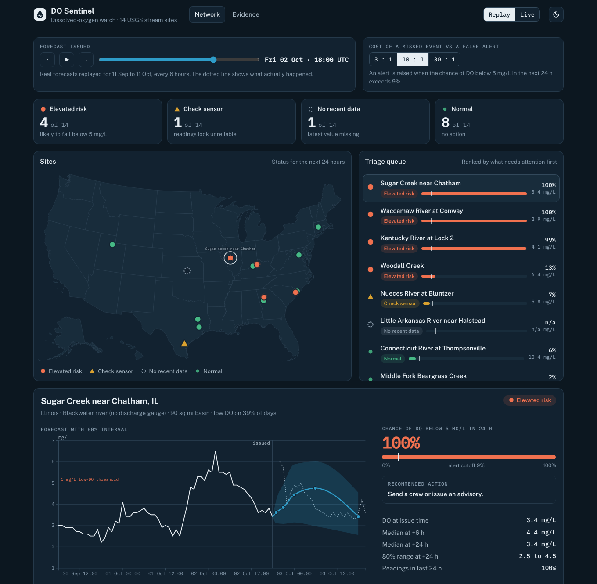

# do-sentinel

Short-horizon **dissolved-oxygen forecasting**, **sensor-fault detection** and **alert triage** for stream sensors, built on public USGS data. Forecasts beat strong baselines by 8 to 31% depending on horizon, intervals are conformally calibrated, and every claim is evaluated walk-forward with confidence intervals, including what did not work.

**Live:** [Dashboard](https://mounusha25.github.io/DO_sentinel/) · [Case study](https://mounusha25.github.io/DO_sentinel/case-study.html) · [API docs](https://do-sentinel-api.onrender.com/docs) · [Model card](MODEL_CARD.md) · [Problem definition](PROBLEM.md) · [All results](reports/RESULTS.md) · [Operating notes](OPERATIONS.md)

[](https://mounusha25.github.io/DO_sentinel/)

## The problem

A field team maintains dozens of oxygen sensors on streams. Low oxygen kills fish, and sensors also fail. Each morning the team must decide which sites need attention in the next 24 hours: a likely low-oxygen event, or a sensor that cannot be trusted. This project forecasts oxygen 1 to 24 hours ahead with calibrated uncertainty, estimates the chance of falling below 5 mg/L, flags suspect readings, and turns that into one of three actions: **warning**, **check sensor** or **no action**. The user, decision and success criteria are fixed in [PROBLEM.md](PROBLEM.md), with a scorecard.

## Results at a glance

Fourteen sites in 11 states, five years of 15-minute data, one year of out-of-sample testing. Skill is the reduction in mean absolute error against the best simple baseline per site.

| Question | Answer |
|---|---|
| Do forecasts beat simple baselines? | **Yes.** The weather-aware boosting gives +24% at 6 h and +14% at 24 h; blended 50/50 with a pretrained model (Chronos-2) it reaches **+31% at 6 h and +16% at 24 h**, at 14 of 14 sites. |
| Are the uncertainty ranges honest? | Raw 80% intervals covered 71 to 76%. After conformal calibration they cover **78 to 79%** (blend, walk-forward: 80.5 to 81.2%). |
| Is the low-oxygen probability useful? | Yes up to 6 h: better than a "current state only" forecaster at about 80% of sites. |
| Do forecast-based alerts beat a one-line rule? | On cost at a 10:1 miss:false-alarm ratio, **yes** (0.9 to 1.1 against 3.6 per site-week). Between the classifier and the interval rule there is no significant difference. |
| Can sensor faults be detected? | Injected spikes 84%, stuck near zero 99%, offsets 65%, flatlines 59%. Slow drift: no. |
| Is the boosting more than a linear model? | Yes, by 4 to 11% MAE at 11 to 13 of 14 sites. |

## What did not work

- **Slow sensor drift** is detectable only when it is large: a drift reaching about 3 mg/L over two weeks is caught 70 to 90% of the time at one false alarm per 5 to 20 weeks, and anything under 1 mg/L is not detectable from one sensor. A neighbouring sensor within 70 km did not help. An early 28% detection rate was chance.
- **The 0.5 alerts/site/week budget does not hold out of sample** (0.4 to 0.7 on average, over 0.5 at 6 to 9 of 14 sites) and is infeasible at the four sites that dip almost nightly, where no rule anticipates anything. At the other ten sites anticipated recall is 0.66 (margin rule) to 0.83 (pooled classifier), with no difference between rules that the 14 sites can resolve (about 0.25 recall).
- **A global model across sites**, and predicting percent saturation, were worse than per-site models.
- **Weather** helps 24 h forecasts (+8.6%) but not alerts.

Several early results looked better than they were and were corrected; see "mistakes I caught" in the case study.

## How it works

| Stage | What | Code |
|---|---|---|
| Ingest | USGS OGC API; keeps approval status; honours `Retry-After` | `src/dosentinel/ingest/` |
| Validate | range, flatline, spike and gap flags; flags annotate, never alter | `validate.py` |
| Features | leakage-safe lags, rolling and calendar terms, saturation, optional weather | `features.py`, `weather.py` |
| Models | per-site quantile gradient boosting, with and without weather; optional 50/50 blend with Chronos-2; direct "low DO within 24 h" classifier | `models.py`, `blend.py`, `foundation.py`, `direct.py` |
| Calibrate | conformal intervals (of the blend too), Platt probability scaling | `calibration.py`, `blend.py` |
| Decide | cost-derived cutoff on the classifier probability, or on the forecast interval where there is no trained classifier; episode-level scoring against chance; sensor-suspect suppression | `decision.py`, `serving.py` |
| Detect faults | causal detectors, synthetic-fault benchmark with a null experiment | `detect.py`, `faults.py` |
| Serve and monitor | FastAPI in Docker, forecast log, scoring of matured forecasts, retrain rule | `serving.py`, `api.py`, `monitoring.py` |
| Drift and scheduled scoring | PSI against each site's own year-to-year variability; a six-hourly GitHub Actions job issues, scores and reports | `drift.py`, `monitoring_job.py`, `.github/workflows/monitor.yml` |
| Experiment tracking | MLflow runs tagged with commit and data hash | `tracking.py` |

Evaluation is chronological and walk-forward; preprocessing, thresholds and calibration are fit only on earlier data; comparisons use identical origins; intervals are cluster bootstraps. Details and every number are in [reports/RESULTS.md](reports/RESULTS.md).

## Repository layout

```
src/dosentinel/    library: ingest, validate, features, models, calibration, decision, faults, serving, api
scripts/           runnable pipelines and experiments (see scripts/README.md)
tests/             160 tests, including leakage tests for every forecaster and feature set
dashboard/         template, precomputed replay data and US map for the dashboard
docs/              built dashboard and case study (served by GitHub Pages)
config/            sites.yaml: the 14 sites, their selection rationale and exclusions
data/              site-selection tables, coordinates and the data manifest (see data/README.md)
results/           result tables written by the scripts (see results/README.md)
reports/           RESULTS.md (all experiments) and EDA.md with figures
models/            trained per-site bundles used by the API
PROBLEM.md  MODEL_CARD.md  OPERATIONS.md  render.yaml  Dockerfile  requirements-lock.txt
```

## Run it

```bash
pip install -e ".[dev,serve]"              # Python 3.11 or newer
pytest                                     # 160 tests
ruff check src scripts tests               # lint

python scripts/build_dashboard.py          # rebuild docs/index.html from dashboard/
docker build -t do-sentinel .
docker run -p 8000:8000 do-sentinel        # http://localhost:8000/docs
```

To regenerate the data and models from scratch (hours, mostly waiting on USGS rate limits):

```bash
export USGS_API_KEY=...                    # free key: https://api.waterdata.usgs.gov/signup
python scripts/pull_data.py --years 5      # raw USGS data for the sites in config/sites.yaml
python scripts/validate_sites.py           # quality flags -> data/clean
python scripts/train_models.py             # per-site bundles -> models/ (adds weather models and blend margins when
                                           #   data/weather and data/chronos2_cache exist)
python scripts/pull_weather.py             # optional: weather for the weather experiments
python scripts/make_manifest.py --check    # verify processed data against data/MANIFEST.json
```

Experiment scripts and what each produces are indexed in [scripts/README.md](scripts/README.md). The pretrained-model experiments need the `foundation` extra (`pip install -e ".[foundation]"`) and were run in a separate virtual environment.

## Operating it

Deployment, the live-request behaviour (weather fetch, fallbacks, optional API keys and rate limit), monitoring and the retrain rule are in [OPERATIONS.md](OPERATIONS.md).

## Limitations

- **One evaluation period.** The final year was reused across experiments; only the forward holdout is untouched, and it has not accumulated yet.
- **Faults are synthetic.** No real labelled sensor faults exist in the data, and the injected shapes are simple.
- **Selection.** Sites were filtered on last-year data quality, which may favour well-instrumented ones; low-oxygen episodes are rare at some sites (as few as 7 in two years).
- **Provisional data is revised** by USGS after the fact, and the model forecasts from what is available now.
- **Weather results use reanalysis** as a stand-in for observed rainfall, and the 24 h weather gain is mildly optimistic.
- **Not a compliance tool.** It supports a human decision; see [MODEL_CARD.md](MODEL_CARD.md).

## Reproducibility

Exact package versions are in [requirements-lock.txt](requirements-lock.txt); `data/MANIFEST.json` holds SHA-256 hashes, sizes, row counts and time ranges of every processed data file; seeds are fixed in the models and set in the scripts; CI runs the tests and lint on every push.

## License

MIT, see [LICENSE](LICENSE). The data are public USGS and Open-Meteo data; check their terms before redistributing derived data at scale.
