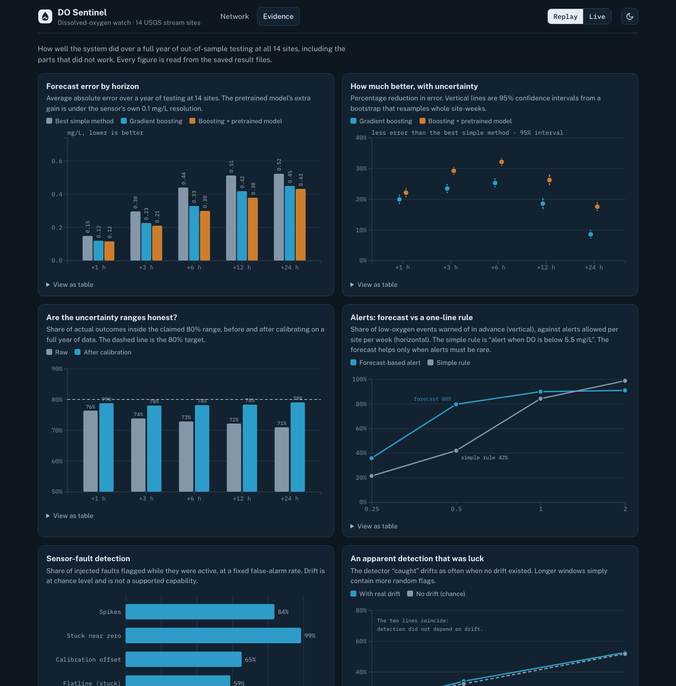

# do-sentinel

Short-horizon **dissolved oxygen (DO) forecasting**, **sensor-fault detection**, and an **alert decision layer** on public USGS continuous water-quality data, packaged as a reproducible MLOps pipeline.

**Live:** [Dashboard](https://mounusha25.github.io/DO_sentinel/) · [Case study](https://mounusha25.github.io/DO_sentinel/case-study.html) · [API docs](https://do-sentinel-api.onrender.com/docs) · [Model card](MODEL_CARD.md) · [Problem definition](PROBLEM.md) · License: MIT

[](https://mounusha25.github.io/DO_sentinel/)


Status: working end to end and deployed. Ingestion, quality flags, baselines, gradient-boosting forecasts with calibrated intervals, a weather experiment, a pretrained-model comparison, a fault-detection benchmark, a monitored API and an interactive dashboard are built and tested. Several results are negative and are reported as such (alerts barely beat a one-line rule; slow sensor drift is not detectable). Not done: a neural network trained from scratch, real labelled faults, and forward-holdout results.

> Exploratory analysis with figures: [reports/EDA.md](reports/EDA.md). The free API server sleeps when idle, so its first request can take about a minute.
>
> See also [MODEL_CARD.md](MODEL_CARD.md) for intended use, results and limitations.
>
> The user, decision, horizons, alert budget and success criteria are fixed in [PROBLEM.md](PROBLEM.md).

## The problem

Low DO events (fish kills, hypoxia) are expensive to miss, but raw sensor feeds are full of fouling, drift, and dropouts that look like real events. A useful system must do three things and keep them from contaminating each other:

1. **Forecast** DO 1 to 24 hours ahead at 15-minute resolution, with calibrated uncertainty.
2. **Detect** sensor faults so bad readings are not mistaken for ecology (and vice versa).
3. **Decide** when to alert, with an explicit cost trade-off between missed events and alert fatigue.

## Scope decisions

- Target: DO (USGS parameter 00300), mg/L.
- Covariates: water temperature (00010), specific conductance (00095), turbidity (63680), discharge (00060) where available.
- Three sites chosen for contrast (flashy urban, regulated, slow river) to test cross-site generalization: USGS-03293500 (Louisville KY), USGS-02344630 (Peachtree City GA), USGS-08065350 (Crockett TX). Chosen via `scripts/discover_sites.py` plus a one-year profile; rationale and alternates are in `config/sites.yaml`.
- Deliberately separate from AzAWH: different data source, different task, public data only.

## Pipeline

| Stage | What | Notes |
|---|---|---|
| Ingest | USGS OGC API `continuous` collection | Keeps `approval_status` and `qualifier`; re-pulls recent window because provisional data is revised |
| Validate | schema, range, gap, flatline, rate-of-change checks | Output: cleaned series + quality flags |
| Features | lags, rolling stats, diel/seasonal terms, discharge-derived storm indicators | Time-aware; no leakage across the forecast origin |
| Train | walk-forward backtesting, MLflow tracking | Splits by time, never random |
| Serve | FastAPI in Docker | Batch and latest-window endpoints |
| Monitor | drift (Evidently), forecast skill tracking, retrain trigger | Retrain when skill or input distribution degrades past a threshold |

## Models

- Baselines first: persistence, seasonal-naive ("same time yesterday"), then gradient boosting (quantile objectives for uncertainty).
- Challenger: LSTM or temporal transformer. It may only match boosting at short horizons; the write-up reports that honestly.
- Evaluation sliced by horizon, season, storm vs baseflow, and site (including leave-one-site-out).

## Anomaly detection (no ground-truth labels)

Three complementary signals, benchmarked against each other:

1. **Weak labels** from USGS `approval_status` and `qualifier` plus provisional-vs-approved value differences (where hydrographers corrected data). Availability to be verified per site.
2. **Synthetic fault injection** (spikes, flatlines, drift ramps, dropouts) into clean segments for a measurable benchmark.
3. **Forecast-residual detector**: flag observations far outside the forecast's predictive interval.

## Decision layer

Converts forecasts and fault flags into one of three actions:

- **Low-DO warning** when predicted P(DO < threshold within horizon) exceeds a cutoff. Threshold is configurable (commonly 5 mg/L for aquatic-life criteria, 2 mg/L for hypoxia; confirm against the applicable standard).
- **Sensor maintenance** when fault score is high; suppresses ecological alerts built on suspect data.
- **No action** otherwise.

The cutoff is chosen by minimizing expected cost under asymmetric miss/false-alarm costs, and reported as precision, recall, lead time, and alerts per week (alert fatigue).

## Repo layout

```
src/dosentinel/ingest/   USGS client and parsing
src/dosentinel/validate.py   quality flags (missing, range, flatline, spike)
src/dosentinel/baselines.py  persistence, seasonal, and diel-delta baselines
src/dosentinel/evaluate.py   walk-forward folds, skill and low-DO onset metrics
src/dosentinel/features.py   leakage-safe features; models.py: quantile GBM
src/dosentinel/detect.py, faults.py   causal fault detectors and synthetic fault injection
src/dosentinel/weather.py          weather features (leakage-aware); scripts/pull_weather.py
src/dosentinel/serving.py, api.py   model bundles, forecast report, FastAPI app
scripts/                 discover_sites.py, pull_data.py, validate_sites.py, run_baselines.py, run_gbm.py
tests/                   parser tests (fixtures are hand-written, not captured responses)
config/                  sites.yaml (three selected sites + alternates, with selection rationale)
```

## Quickstart

```bash
python -m venv .venv && source .venv/bin/activate
pip install -e ".[dev]"
pytest
python scripts/discover_sites.py --state-name Arizona --out data/site_candidates.csv
```

Optional: set `USGS_API_KEY` for higher rate limits (check current USGS guidance).

## Results so far (14 sites, 5 years of history, 2-year walk-forward test)

Sites span basins from 3 to 16,600 sq mi across 11 states; 976 low-DO episodes (< 5 mg/L) in the test window. Models are trained only on data before each test fold, with a 90-day calibration window in between.

- **Point forecasts:** quantile gradient boosting beats the best baseline at 13-14 of 14 sites at every horizon. Mean MAE improvement: 17% (1 h), 22% (3 h), 24% (6 h), 18% (12 h), 7.5% (24 h). Gains are small at 24 h.
- **Intervals:** raw 80% intervals under-cover (0.72-0.78); conformal calibration brings the cross-site mean to 0.80 at every horizon.
- **Probabilities:** the classifier beats a "current state only" forecaster at about 80% of sites for horizons up to 6 h (median Brier skill 0.24-0.29) but not at 24 h. With a 90-day calibration window Platt scaling could be fit in only about half of the folds (events are seasonal); a 365-day window raises that to 88%.
- **Alerts:** scored per episode against chance and against the naive rule "alert when DO < threshold + 0.5 mg/L". Every model-based rule is far better than chance. Alerting on the maximum of per-horizon probabilities beat the naive rule on cost at only 2 of 14 sites. Training and calibrating a classifier directly on "any DO below 5 mg/L in the next 24 h" (`scripts/run_decision_direct.py`) improved that to 5 of 14 (median cost 1.2x naive) while sending about half as many alerts, but it misses more episodes at low-event sites (anticipated recall 0.67-0.85 at three sites) and still has lower precision than the naive rule at 13 of 14. Its probability is genuinely informative (beats a state-only forecaster at 13 of 14 sites, median Brier skill 0.26) but that does not translate into clearly cheaper alerting than a simple margin rule. At one site (USGS-01184000, 3% event rate, no events in any calibration window) it never alerts; such sites should fall back to the margin rule. Longer calibration windows (365 days) fixed probability scaling (applied in 88% of folds instead of 51%) but did not change the alert comparison.
- **Cross-site transfer (leave-one-site-out):** a model trained only on the other 13 sites beats the best baseline at 9/12/9 of 14 sites (1/6/24 h) and keeps roughly half of the site-specific gain at 1-6 h and almost none at 24 h. Pooling does help the rare-event probability model.

Caveats: lead time is a weak metric where episodes recur daily; the alert comparison depends on probability calibration that is incomplete (see above); site selection was filtered on last-year data quality, which may favour well-instrumented sites. See `results/` and `config/sites.yaml`.

## Improvement experiments (with confidence intervals)

Point-forecast variants scored on identical origins, 14 sites, 2-year walk-forward test. Intervals are cluster bootstrap (`scripts/analyze_improve.py`); the site-level interval is the conservative one.

| Horizon | Current local model vs best baseline | + saturation features | Saturation-fraction target | Global model (all sites) | Local + global blend |
|---|---|---|---|---|---|
| 1 h | +18.3% [site CI +12, +24] | 0.0% | -3.2% | -4.2% | 0.0% |
| 6 h | +24.7% [+21.5, +27.8] | **+1.1%** [+0.3, +1.8] | -6.3% | -4.4% | +0.9% [+0.2, +1.6] |
| 24 h | +7.7% [+5.2, +10.2] | +0.5% [-0.0, +1.0] | -5.0% | -0.8% | **+1.1%** [+0.6, +1.5] |

(Columns 3-6 are changes relative to the current local model.)

- The headline forecast skill is robust to resampling. The refinements are small: saturation features and a local+global blend add about 1% MAE at 6-24 h and nothing at 1 h. Predicting percent saturation as the target and a pure global model are worse than the local model.
- Conclusion: these inputs are close to what the site's own history can support. Larger gains need new information; weather was tested next (see Weather experiment): it helps the median forecast at 12-24 h but not the low-DO alerts.
- **Alerts at a matched alert budget** (best anticipated recall each rule can reach without exceeding N alerts per week, parameters chosen per site on the test window): at 0.5 alerts/week the calibrated-probability rule reaches recall 0.80 against 0.42 for the naive margin rule (paired difference +0.38, 95% CI +0.03 to +0.69, but model better at 8 sites, worse at 3, sign test p = 0.23); at 1 per week they tie; at 2 per week the naive rule is better (0.99 vs 0.91). A hybrid "naive AND probability above a cutoff" is worse than the naive rule. Model-based alerting therefore helps mainly when alert volume must be very low. See `results/alert_budget_*.csv`.

## Weather experiment

Does weather information improve DO forecasts? Weather from Open-Meteo: rainfall that has already fallen (ERA5, a stand-in for radar/gauge rainfall) and, for the target window, the GFS forecast issued about a day earlier, so it existed at the forecast origin. Archived precipitation/radiation forecasts only start on 2024-01-19, so the realistic test uses that shorter history (last year as test); an "upper bound" run replaces forecasts with the weather that actually happened, on the full 5 years. Each comparison uses identical rows, folds and training window (`scripts/run_weather.py`, `run_weather_alerts.py`; leakage tests in `tests/test_weather.py`).

| Horizon | Weather vs no weather (realistic forecasts) | Perfect-forecast upper bound | Skill vs best baseline, without -> with weather (realistic) |
|---|---|---|---|
| 6 h | +2.2% [+1.7, +2.6] | +2.8% | 22.8% -> 24.5% |
| 12 h | +4.7% [+4.1, +5.4] | +5.4% | 13.8% -> 17.9% |
| 24 h | **+8.6%** [+7.7, +9.6] | +10.0% | 5.8% -> **14.0%** |

- Better at all 14 sites at every horizon (site-level CIs exclude zero); realistic forecasts retain about 80-87% of the upper bound. At 24 h the weather model also beats the long-history model without weather by 6.1% [+5.0, +7.1].
- **Sunlight and air temperature carry most of the gain, not rain.** At 24 h: air temperature + sunlight only +6.4%, rain only +3.7%, all +8.6%. The gain is as large in dry target windows (8.6%) as in wet ones (8.6%); at 6-12 h wet windows gain more (5.1% vs 1.5% at 6 h).
- **It does not carry through to low-DO alerts.** The probability of DO falling below 5 mg/L within 24 h improves by +2.4% [-2.4, +6.7] (realistic; better at 8 of 14 sites) and by +4.0% [+1.0, +6.9] even with perfect weather (also 8 of 14); anticipated recall at a fixed alerts-per-week budget is unchanged or slightly lower. So the alerting result does not depend on weather information.
- Caveats: the realistic test is one year with 1.5-2.5 years of training; at 24 h the forecast used is about 5 h fresher than a model run could have been at the origin, so the 24 h gain is mildly optimistic; ERA5 stands in for observed rainfall; the Open-Meteo model grid differs from the gauge location. The API serving layer does not yet use weather.

## Pretrained foundation model (Chronos-Bolt, zero-shot)

Amazon's Chronos-Bolt (48M parameters), used with no training on this project's data, against the tuned local gradient boosting (history + saturation features, no weather), on identical hourly origins over the last year (14 sites, about 4,100 origins per site and horizon; `scripts/run_chronos.py`). Chronos sees only the previous 512 hourly DO values; gaps are passed as missing.

| Horizon | Chronos vs best baseline | Gradient boosting vs best baseline | Chronos vs gradient boosting |
|---|---|---|---|
| 1 h | +4.3% [+2.6, +5.9] | +20.1% | **-19.7%** [-21.9, -17.8] |
| 6 h | +16.7% [+15.2, +18.0] | +25.3% | -11.6% [-13.6, -9.7] |
| 12 h | +7.9% [+6.1, +9.6] | +18.4% | -12.9% [-15.0, -10.8] |
| 24 h | -2.0% [-3.4, -0.8] | +8.4% | -11.4% [-13.2, -9.6] |

- Zero-shot, a pretrained model beats the simple baselines at 1-12 h but loses to the tuned gradient boosting at every horizon, and at 12-14 of 14 sites. At 24 h it is no better than the best simple baseline.
- Its raw 80% intervals are closer to nominal (coverage 0.77-0.85 vs 0.72-0.77) but wider; pinball loss is worse at every horizon.
- Averaging Chronos and the gradient boosting helps slightly at 3-6 h (+1.4-1.5%, CI excludes zero) and not at other horizons.
- Caveat: the comparison favors the gradient boosting by construction, since Chronos-Bolt here is univariate and sees no temperature, conductance, discharge or weather. It answers "does a pretrained model beat a tuned, covariate-aware model out of the box?", not "could a fine-tuned or covariate-aware foundation model?". The test year post-dates the model's pretraining.

## Chronos-2 with covariates (zero-shot) and the blend

Chronos-2 (119M parameters, pretrained, **no training on this project's data**) given the same covariates the gradient boosting uses: past water temperature, conductance, turbidity and discharge (`wq`), plus weather (`wx`: past observed, future as the forecast issued a day earlier). Same hourly origins (every 4 h, last 364 days, 14 sites, about 10,300 per horizon), same targets, bootstrap CIs (`scripts/run_chronos2.py`).

| Horizon | Chronos-2 DO only | Chronos-2 + water covariates | Chronos-2 + weather | GBM (no weather) | GBM + weather | **Blend of Chronos-2 + GBM (both with weather)** |
|---|---|---|---|---|---|---|
| 1 h | +14.2% | +14.9% | +12.4% | +19.8% | +19.3% | **+21.4%** |
| 3 h | +22.3% | +26.1% | +24.9% | +23.4% | +21.9% | **+28.3%** |
| 6 h | +22.1% | +28.4% | +27.7% | +25.2% | +24.6% | **+31.3%** |
| 12 h | +13.0% | +20.4% | +21.1% | +18.4% | +17.9% | **+25.5%** |
| 24 h | +0.6% | +4.9% | +9.4% | +8.4% | +14.0% | **+17.4%** |

(MAE skill versus the best simple baseline; all intervals in `results/`.)

- Covariates are what make the pretrained model competitive: Chronos-2 on DO alone loses to the tuned gradient boosting at 3-24 h; with water covariates it beats it at 3-12 h (+3.6%, +4.2%, +2.5%; better at 10, 12 and 10 of 14 sites) and loses at 1 h (-6.2%) and 24 h (-3.9%).
- At 24 h the gradient boosting with weather is the best single model (+14.0%).
- An unweighted 50/50 average of the two families beats the better single model at every horizon: +3.5% (1 h), +5.6% (3 h), +6.0% (6 h), +6.4% (12 h), +4.0% (24 h) with weather, all with CIs excluding zero. The weights were not tuned.
- Interval quality: Chronos-2's raw 80% intervals cover 0.72-0.81 (gradient boosting 0.67-0.77) and have lower pinball loss at 1-12 h; the gradient boosting is better at 24 h.
- Caveats: the 24 h weather result is mildly optimistic (forecast about 5 h fresher than available); the gradient boosting with weather had a shorter training history (from 2024-01-20); the test year was used for earlier experiments (Chronos-2 itself was not tuned on it); I could not verify Chronos-2's pretraining data cutoff; ERA5 stands in for observed rainfall; no conformal calibration has been applied to the blend yet.

## Classical statistical baseline

Holt-Winters exponential smoothing with an additive 24-hour season, refit at every origin on the previous 14 days of hourly DO, no covariates (`scripts/run_stats_baseline.py`; 46,000 forecasts at 00:00 and 12:00 UTC, 14 sites, last year, identical rows to the other models).

| Horizon | ETS vs best simple baseline | GBM vs best simple baseline | Chronos-Bolt (zero-shot) vs best baseline | GBM vs ETS |
|---|---|---|---|---|
| 1 h | -5.1% [-8.3, -2.0] | +18.2% | +5.0% | +22.2% |
| 3 h | -16.5% [-20.9, -12.0] | +24.1% | +17.1% | +34.8% |
| 6 h | -36.6% [-44.6, -29.1] | +23.1% | +14.1% | +43.7% |
| 12 h | -55.2% [-65.5, -45.7] | +17.4% | +7.4% | +46.8% |
| 24 h | +0.0% [-0.2, +0.2] | +8.4% | -1.9% | +8.4% |

- The classical method is worse than "same as an hour ago plus yesterday's change" at 1-12 h, and at 24 h it effectively reproduces the last value. It is a weak baseline here and establishes that the gradient boosting's gain is not just "any model with a daily season".
- Caveats: one classical specification (no trend, no covariates); a seasonal ARIMA with exogenous inputs was not tried.

## Sensor-fault detection (synthetic benchmark)

USGS-approved data has had its faults removed, so detectors are scored on faults injected into the final year of each site's clean data (spike, stuck sensor, offset, slow drift, stuck near zero; 3 severities; about 1,900 events over 14 sites). Detectors are causal. Thresholds come from a clean calibration year; "equal footing" thresholds set every detector to 0.67 false flags per week on the test year's own normal steps. A fault counts as detected only if flagged while it is active. See `scripts/run_faults.py` and `results/faults_*.csv`.

| Fault | Best detector (equal footing) | Detected | Notes |
|---|---|---|---|
| Spike | 1-hour forecast interval | 85% (67% small, 98% large) | caught at onset |
| Stuck near zero | any jump-based detector | 95-100% | caught at the jump |
| Offset | 1-hour forecast interval | 67% (38% for 0.5 mg/L, 86% for 2 mg/L) | caught at onset |
| Flatline | run-length | 73% | forecast-based detectors catch about 1-7%; the existing rules (72 h limit) catch 0% of these faults (median 16 h) |
| Slow drift | none reliable | at chance for 0.5-1 mg/L; about +9-14 points over chance for 2 mg/L over 7+ days (long-lag detector) | see the drift note below; the earlier 28% figure was chance |

- **Drift note (`scripts/run_drift.py`):** a "zero-magnitude drift" null experiment shows the 1-hour forecast-interval detector's drift "detection" is chance: it depends on window length (21% / 32% / 52% for 3 / 7 / 14 days even with no drift) and not on magnitude. Detectors anchored on DO from 15-21 days ago (so a drift under 15 days has not contaminated the reference) add a real but small signal, only for 2 mg/L drifts lasting 7+ days (detection 17-31% against 8-12% chance, with equal-footing thresholds). The 72-hour-mean residual noise is 0.3-1.4 mg/L (median 0.55), the same size as the drifts, so small drift is fundamentally hard to see from one DO sensor plus covariates. Thresholds set on the calibration year do not transfer for these detectors (15-27 false flags/week against a target of 0.67). Do not rely on this system to catch slow drift; scheduled field checks are the safer control.
- A covariate-only model (DO predicted from temperature, conductance, turbidity, discharge) was meant to see drift that persistence-based residuals absorb. It did not: 6-25% detection and unstable thresholds. It is not useful in this form.
- Combining all detectors with a shared false-alarm budget is worse than the best single detector per fault type (e.g. spikes 66% combined vs 85%); a per-fault-type union is the better design.
- Persistence-based detectors double-flag: a fault contaminates the "same time yesterday" features, so flags recur a day later (12.7 false flags/week vs 0.94 once echoes are excluded). Needs echo suppression before use.
- Lowering the rules' flatline limit to 6 h catches every injected flatline but produces about 16 false flags/week on real data.
- Caveats: the fault shapes are simple and mine; one random draw per site; real probe failures are messier.

## Serving

```bash
pip install -e ".[serve]"
python scripts/train_models.py                    # one bundle per site -> models/*.joblib
DOSENTINEL_MODELS=models USGS_API_KEY=... uvicorn dosentinel.api:app
curl localhost:8000/forecast/USGS-03293500        # live pull of the last 40 days from USGS
```

- `GET /health`, `GET /sites`
- `GET /forecast/{site_id}?cost_ratio=10`: pulls the latest data (cached 5 min), returns forecasts at 1, 3, 6, 12 and 24 h with conformal 80% intervals, the calibrated probability of DO falling below the threshold within 24 h, fault flags, and a recommended action (`none`, `warning`, `maintenance`).
- `POST /forecast/{site_id}`: same, from series you supply (`{"series": {"00300": [{"time": ..., "value": ...}], ...}}`); useful offline and for replays.

Serving reuses the evaluated feature, model, calibration and detector code. The `Dockerfile` has been built and run (non-root user, health check, about 860 MB, about 160 MiB of memory in use). Bundles record their training and calibration dates; retrain on a schedule. Every response carries the evaluation caveats: alerting is competitive with, not better than, a simple threshold rule, and slow drift is not reliably detected.

## Deployment

| Part | Where | How |
|---|---|---|
| Dashboard (static replay) | GitHub Pages: https://mounusha25.github.io/DO_sentinel/ | serves `docs/`, rebuilt by `python scripts/build_dashboard.py` |
| Case study | https://mounusha25.github.io/DO_sentinel/case-study.html | same site |
| API (live forecasts) | any container host | `Dockerfile` + `render.yaml` |

```bash
docker build -t do-sentinel .
docker run -p 8000:8000 do-sentinel          # http://localhost:8000/docs for the interactive API
```

On Render: New > Blueprint, pick this repository; `render.yaml` sets the build, the health check and the CORS origin. The trained bundles in `models/` are committed so any git-based host can build the image; regenerate them with `python scripts/train_models.py`.

Operating notes:

* **A USGS API key is required on a shared host.** Anonymous requests from a cloud address share a quota with other users of that address; the deployed service was answered with HTTP 429 and `Retry-After` of 2 to 11 minutes, so every live forecast failed. Create a free key at https://api.waterdata.usgs.gov/signup and set it as the `USGS_API_KEY` environment variable in the host's dashboard (never in the repository). With a key the limit is per key (1,000 requests per hour); a live forecast uses five requests per site and is cached for ten minutes. Without one the API returns 503 quickly, serves the last good data marked `stale` if it has any, and `POST /forecast/{site}` with your own series still works.
* **Public and unauthenticated.** Anyone can call `/forecast`; payloads are capped at 20,000 observations, and CORS is limited to `DOSENTINEL_CORS`. Add authentication before using it for anything beyond a demonstration.
* **Models do not update themselves.** They were trained through 2025-10 and calibrated on the following year; see the retraining policy in MODEL_CARD.md. Forecast logging (`DOSENTINEL_LOG`) writes to the container's disk, which is ephemeral on most free hosts.
* **Free tiers sleep** after inactivity, so the first request after a pause can take about a minute.

## Dashboard

[](https://mounusha25.github.io/DO_sentinel/#evidence)

**`reports/dashboard.html`** is a standalone, interactive dashboard (open the file in a browser; no server). It replays *real* model output for the last 30 days of data across all 14 sites:

* a network view: US map with each site's status (elevated risk, check sensor, no recent data, normal), a ranked triage queue, and counts you can click to filter;
* a time control (step, slider or play) and a cost-ratio setting that moves the alert cutoff;
* a site view: forecast with its 80% interval against what actually happened, the probability of low DO with the alert cutoff, sensor checks, and a 30-day history of past risk and what followed;
* an Evidence tab with the evaluation results and what did not work, every figure read from the saved result files.

```bash
python scripts/build_dashboard_data.py   # forecasts from models/*.joblib and tables from results/ -> reports/dashboard/data.json
python scripts/build_dashboard.py        # template + data + map -> reports/dashboard.html
```

The page needs an internet connection only to load its charting library and font. The replay is not live data: models were trained on data before 2025-10-12, and their interval and probability calibration used the following year, which includes the replay window. `app/dashboard.py` is an earlier, simpler Streamlit replay tool.

## Monitoring

```bash
DOSENTINEL_LOG=logs/forecasts.jsonl uvicorn dosentinel.api:app   # log every live forecast
curl localhost:8000/monitor/USGS-03293500                        # score matured forecasts, retrain rule
```

* Each live response reports data age and input completeness; every served forecast can be logged and later scored against observed values (this is the forward holdout in PROBLEM.md).
* The retrain rule fires on live MAE more than 1.25x its evaluation level (with at least 200 matured forecasts), interval coverage below 0.65, more than 30% of DO missing over a week, or a model older than a year.
* An out-of-sample check of 120 forecasts at one site showed well-calibrated probability bins (forecast 90-100% followed by an event 7 of 7 times; 0-10% by an event 1% of the time).

## Reproducibility

* Exact package versions: [requirements-lock.txt](requirements-lock.txt) (main environment and the isolated `.venv-ai` used for the foundation-model experiments).
* Data: `python scripts/make_manifest.py --check` verifies every processed data file against `data/MANIFEST.json` (SHA-256, size, row counts, time range). Raw USGS values are revised upstream, so the hashes identify the snapshot behind every reported number.
* Seeds are fixed in the models; walk-forward folds and bootstrap seeds are set in the scripts.

## Reproducing from a clean checkout

Large data and model files are not in the repository; they are regenerated (and the
hashes of the processed data are in `data/MANIFEST.json`).

```bash
pip install -e ".[dev,serve]"          # Python 3.11+; exact versions in requirements-lock.txt
export USGS_API_KEY=...                # optional, raises the USGS rate limit
python scripts/pull_data.py --years 5  # raw USGS data for the sites in config/sites.yaml
python scripts/pull_weather.py         # Open-Meteo weather (for the weather experiments)
python scripts/validate_sites.py       # quality flags -> data/clean
python scripts/train_models.py         # serving bundles -> models/
pytest                                 # tests
streamlit run app/dashboard.py         # replay dashboard
```

The pretrained-model experiments (`run_chronos*.py`) need `chronos-forecasting`, `torch` and
`transformers`; they were run in a separate virtual environment.

## Known risks

- USGS is migrating from legacy `waterservices` to the OGC `api.waterdata.usgs.gov`; endpoints and field names may change. `discover_sites.py` and the client have been run against the live service (field names verified; `state_name`, not a state code, is the filter). Unauthenticated use is limited to 1,000 requests/hour; set `USGS_API_KEY`.
- Not every site has all parameters; long gaps are common.
- Provisional values change after ingestion; the pipeline must be idempotent and revision-aware.

## License

MIT, see [LICENSE](LICENSE). The data are public USGS and Open-Meteo data; check their terms before redistributing derived data at scale.
