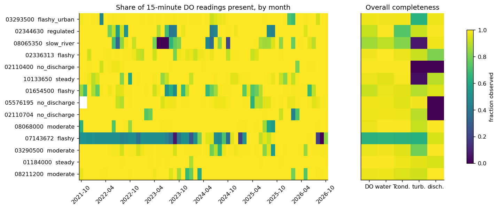
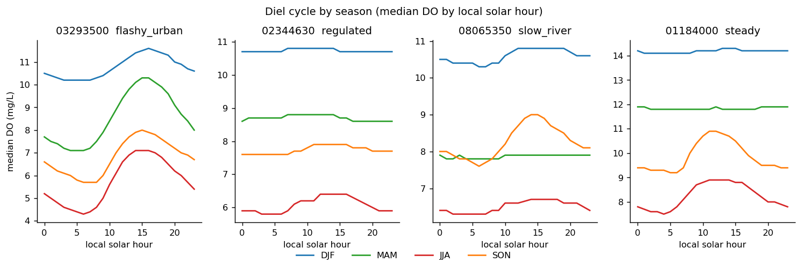
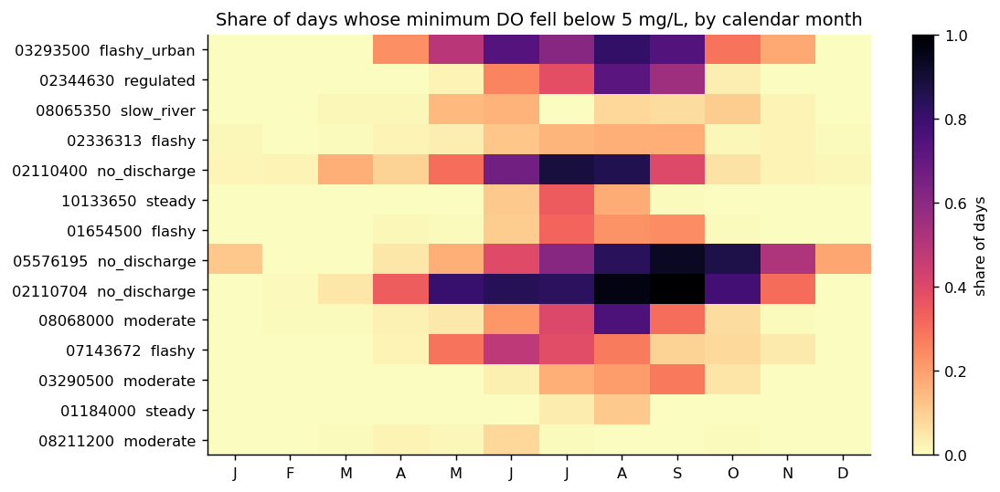
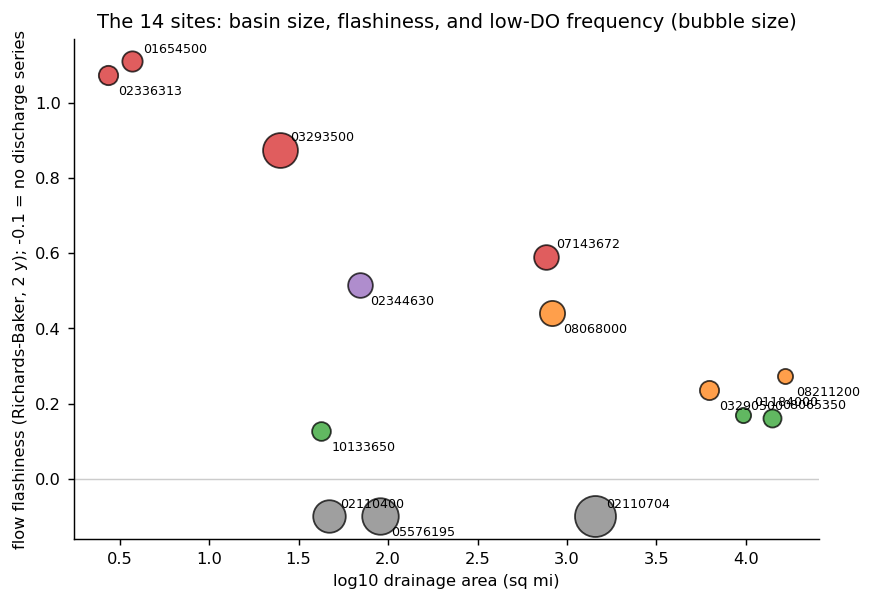
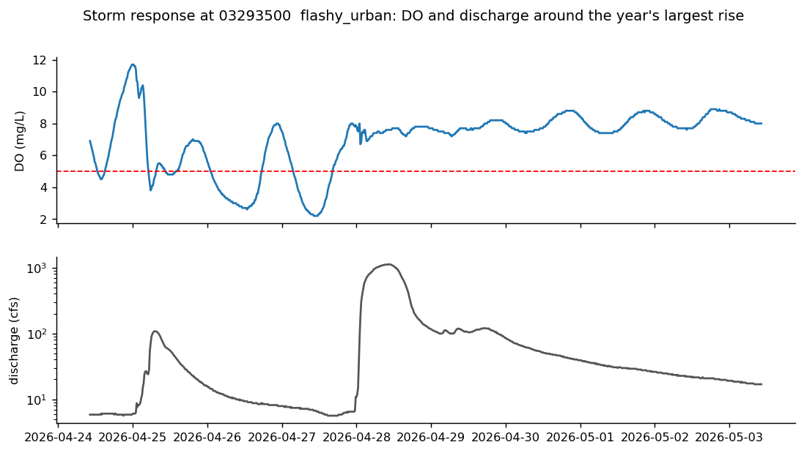
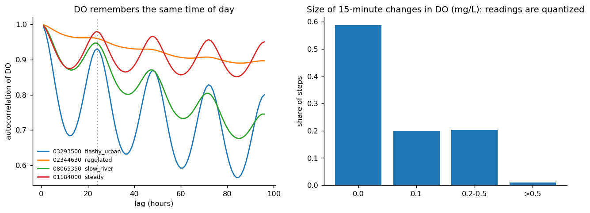
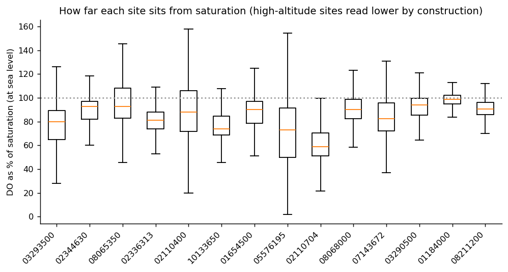

# Exploratory analysis: what the data showed and what we did about it

Figures are in `reports/eda/`; numbers in `reports/eda/eda_numbers.json`
(regenerate with `python scripts/make_eda.py`). Every finding below led to a modeling decision.

## 1. Missingness is mostly small, but whole covariates are sometimes absent

* DO is 97% complete at the median site (worst 64%, USGS-07143672).
* Three sites have no discharge series at all, and three have turbidity under 50% complete.
* **Decision:** no imputation. The gradient boosting handles missing inputs natively; covariates
  are optional features; a site with under two years of history (USGS-03432100) was excluded.

## 2. The daily cycle is strong at some sites and absent at others, and it changes with season

* At the urban stream the median daily swing is 1.4 mg/L in winter and 2.8-3.2 mg/L in spring and
  summer. Below the lake, the regulated site stays within 0.1-0.6 mg/L all year. The large steady
  river is flat in winter and spring (0.1-0.2 mg/L) and swings 1.4-1.7 mg/L in summer and autumn.
* **Decision:** a "same time yesterday" baseline works at the flashy sites and fails at regulated
  ones, so we used per-site models with calendar terms rather than one global model (a pooled
  model was in fact worse than per-site ones).

## 3. Low oxygen is a summer and early-autumn problem everywhere

* Averaged over sites, 36% of days in June-September had a minimum below 5 mg/L, against 0.9% in
  December-February; at all 14 sites the summer share is more than twice the winter share.
* Three sites without a discharge series (two in the Southeast, one in Illinois) reach 90% or
  more of days below 5 mg/L in their worst months.
* **Decision:** probability scaling needs a calibration window that spans a year (a 90-day
  window had no events in most folds, so scaling could be fit in only about half of them);
  evaluation uses full-year test periods and is read seasonally.

## 4. The sites genuinely differ

* The three smallest basins (under 30 sq mi) are the flashiest (Richards-Baker 0.88-1.11) and the
  four largest rivers are steady (0.16-0.27); in between, regulation matters more than size (0.52
  below a lake, 0.13 for a small tailwater). Bubble size is how often a day dips below 5 mg/L.
* **Decision:** sites were picked to contrast in size, flashiness and low-DO frequency, so cross-site
  results are not just one kind of river repeated.

## 5. A storm raised oxygen here; it did not lower it

* At the urban stream, DO was swinging between 2 and 7 mg/L for days; the year's largest rise in
  discharge pushed it to 7-9 mg/L and flattened the daily swing. The 1-hour correlation between DO
  change and discharge change is -0.002: the effect is a regime change over days, not a co-movement.
* I had expected storms to cause dips; for this site the opposite holds (flushing and
  reaeration).
* **Decision:** keep discharge-derived storm indicators as features. The persistence-plus-
  yesterday's-shape baseline is 11-22% less accurate in storm windows at 6-24 h (no worse at
  1-3 h), and its advantage over plain persistence shrinks sharply there (at this site from 61%
  to 9% at 6 h), because the daily pattern it extrapolates has just been wiped out.

## 6. Yesterday predicts today

* DO's autocorrelation has a peak at 24 h of 0.93-0.98 across the sites shown.
* **Decision:** "same time yesterday" and "now plus yesterday's change" are the strong baselines;
  lag features at 24 h are included.

## 7. Readings are quantized, so flat stretches are normal
* 59% of 15-minute changes are exactly 0.0 mg/L and a further 20% are 0.1 mg/L (the instrument's
  resolution).
* **Decision:** a 6-hour flatline rule flagged 26% of normal DO at two sites; the limit was raised
  to 72 h (and the pretrained model's 0.03 mg/L gain is below this resolution).

## 8. Sites sit at very different distances from saturation

* Median DO ranges from 59% of saturation (a blackwater river) to 99% (a large steady river); the
  high-altitude site reads lower by construction because saturation was computed at sea level.
* **Decision:** saturation-based features were added; they gave a small gain (about 1% at 6 h).
  Elevation correction was not applied and is a known limitation.
